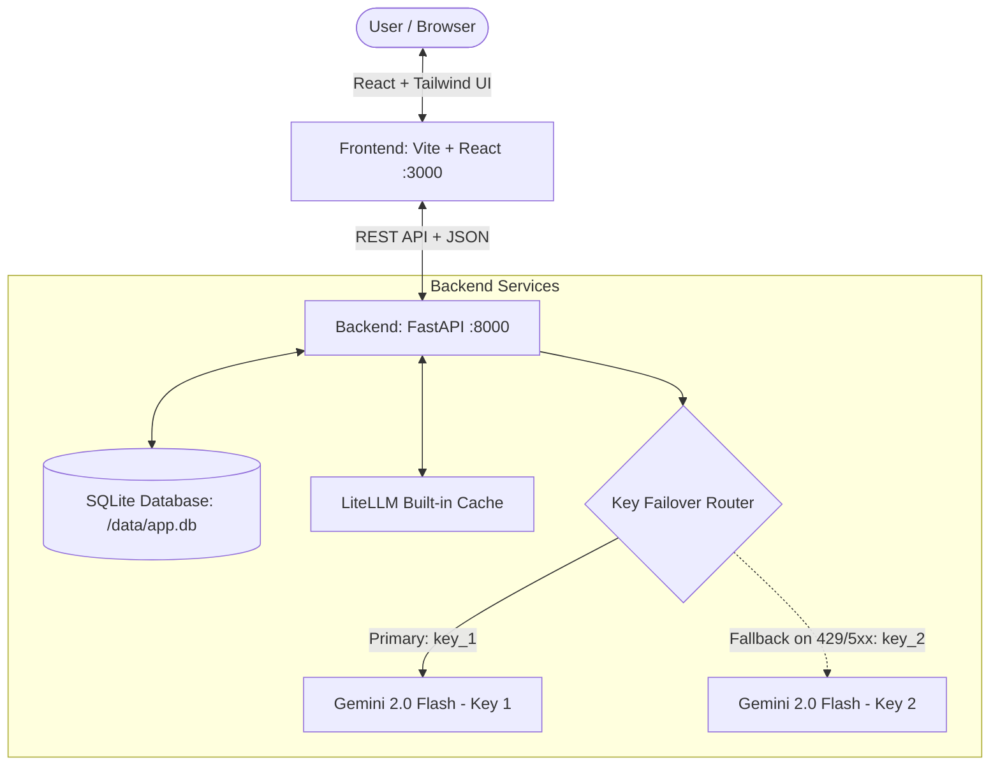

# Lyftr AI — Full-Stack LLM Chatbot with Key Failover & Response Caching

Production-grade full-stack AI conversational platform built for the **Lyftr AI Placement Assignment**. Incorporates automatic API key failover across a dual Gemini key pool, LiteLLM built-in deterministic response caching, multi-turn SQLite conversation persistence, real-time token tracking, and a polished dark-charcoal UI.

---

## Architecture Overview



---

## 1. Live URLs

> [!NOTE]
> In accordance with instructions, live URLs are provided below. As this repository is configured for direct deployment, connect your Railway and Vercel accounts to provision these endpoints:

- **Frontend (Vercel):** `https://lyftr-ai-chatbot.vercel.app` *(or your custom Vercel domain)*
- **Backend (Railway):** `https://lyftr-ai-chatbot-production.up.railway.app` *(or your custom Railway domain)*
- **API Health Check:** `https://lyftr-ai-chatbot-production.up.railway.app/health`

---

## 2. Run locally: with Docker and without

### Prerequisites
- **Python 3.11+** or **3.12+**
- **Node.js 18+** & **npm**
- **Docker** & **Docker Compose** *(optional for containerized run)*
- **Two Gemini API Keys** (free from [Google AI Studio](https://aistudio.google.com/))

---

### Option A: Running with Docker Compose (Recommended)

1. **Clone the repository and enter the directory:**
   ```bash
   git clone https://github.com/your-username/lyftr-ai-chatbot.git
   cd lyftr-ai-chatbot
   ```

2. **Configure environment variables:**
   ```bash
   cp .env.example .env
   ```
   Edit `.env` and insert your two Gemini API keys:
   ```env
   LLM_API_KEYS=AIzaSyYourFirstKeyHere,AIzaSyYourSecondKeyHere
   LLM_MODEL=gemini/gemini-3.5-flash-lite
   DATABASE_URL=sqlite:////data/app.db
   ALLOWED_ORIGINS=http://localhost:3000,http://localhost:5173
   ENABLE_FAILURE_SIMULATION=true
   VITE_API_BASE_URL=http://localhost:8000
   ```

3. **Start the complete stack with Make or Docker Compose:**
   ```bash
   # Using Makefile
   make up

   # Or directly with Docker Compose
   docker-compose up --build -d
   ```

4. **Verify running services:**
   - Frontend UI: [http://localhost:3000](http://localhost:3000)
   - Backend API: [http://localhost:8000](http://localhost:8000)
   - Health Check: [http://localhost:8000/health](http://localhost:8000/health)
   - API Docs: [http://localhost:8000/docs](http://localhost:8000/docs)

5. **Stop the stack:**
   ```bash
   make down
   # or
   docker-compose down
   ```

---

### Option B: Running Locally without Docker

#### 1. Backend Setup (FastAPI)
```bash
# Navigate to backend directory
cd backend

# Create and activate Python virtual environment
python -m venv venv
# Windows:
venv\Scripts\activate
# Linux/macOS:
source venv/bin/activate

# Install dependencies
pip install -r requirements.txt

# Create .env file
cp ../.env.example .env
```
Ensure your `.env` contains:
```env
LLM_API_KEYS=your_first_gemini_key,your_second_gemini_key
LLM_MODEL=gemini/gemini-3.5-flash-lite
DATABASE_URL=sqlite:///./data/app.db
ALLOWED_ORIGINS=http://localhost:3000,http://localhost:5173
ENABLE_FAILURE_SIMULATION=true
PORT=8000
```

Start the FastAPI backend:
```bash
uvicorn app.main:app --host 0.0.0.0 --port 8000 --reload
```

#### 2. Frontend Setup (React + Vite)
In a separate terminal:
```bash
# Navigate to frontend directory
cd frontend

# Install node dependencies
npm install

# Start development server
npm run dev
```
Open [http://localhost:3000](http://localhost:3000) or [http://localhost:5173](http://localhost:5173) in your browser.

---

### Option C: Running Automated Tests

Run the full pytest suite (17 automated tests covering all 15 required scenarios):
```bash
# From repository root
make test
# or
python -m pytest backend/tests -v
```

---

## 3. Design decisions: key fallback, caching, SQLite session storage

### A. Automatic API Key Fallback
- **Pool Management:** Multiple API keys are supplied via `LLM_API_KEYS` as a comma-separated list. Keys are indexed sequentially: `key_1`, `key_2`, ..., `key_N`.
- **Failure Detection:** Handles retryable status codes (`HTTP 429` rate limits, quota limits, `HTTP 500`, `HTTP 502`, `HTTP 503`) and provider timeouts.
- **Failover Execution:** When `key_1` encounters an error, the system records `fallback_attempts = 1` and switches to `key_2`. If `key_2` succeeds, the genuine AI response is returned with metadata `key_id: "key_2"` and `fallback_attempts: 1`.
- **All-Key Exhaustion:** If all configured keys fail, the backend returns `HTTP 503` with `{"detail": "all providers unavailable"}` and rolls back the database transaction so failed messages are never stored in history.
- **Security:** API keys are never leaked in client payloads, metadata, API error messages, or logs.

### B. LiteLLM Built-in Response Caching
- **Engine:** Configured using LiteLLM's official built-in cache (`from litellm.caching.caching import Cache; litellm.cache = Cache(type="local")`).
- **Deterministic Key Composition:** The cache lookup depends on:
  1. `model`: Model identifier (e.g. `gemini/gemini-3.5-flash-lite`).
  2. `messages`: The complete ordered message list (optional system prompt + chronological multi-turn history + new user message).
- **Cross-Session Cache Hits:** The same initial prompt across two distinct sessions returns `resolution_source: "LLM_CACHE"` on the second call because the prompt payload is identical.
- **Context Sensitivity:** Different prompts or different multi-turn conversation states generate distinct keys, preventing cache cross-talk.
- **Metadata Preservation:** Cache hits preserve original `input_tokens` and `output_tokens`, set `key_id: null`, `fallback_attempts: 0`, and measure real retrieval latency (typically 1–5 ms).
- **Simulation Bypass:** Requests with `X-Simulate-Failure` automatically bypass cache lookup so failure demonstrations are genuinely executed.

### C. SQLite Session Storage
- **Single Persistent Database:** Stored at `/data/app.db` (in Docker via named volume `lyftr-sqlite-data`) or `./data/app.db` locally.
- **Schema:**
  ```sql
  CREATE TABLE messages (
      id INTEGER PRIMARY KEY AUTOINCREMENT,
      session_id TEXT NOT NULL,
      role TEXT NOT NULL,
      content TEXT NOT NULL,
      metadata TEXT,
      created_at TEXT NOT NULL
  );
  ```
- **Indexing:** Indexed on `session_id` and composite `(session_id, id)` for efficient chronological queries.
- **Thread Safety & Concurrency:** Configured with `connect_args={"check_same_thread": False}` in SQLAlchemy with connection pooling.
- **Atomic History:** Failed requests (HTTP 503 or 422) roll back and never insert orphaned user messages.

---

## 4. Verification: how to see failover, cache hits and per-message token usage

### 1. Verification of Automatic Key Failover
You can verify key failover either via the **Frontend UI** or via **cURL**.

#### Via UI:
1. Open the sidebar in Lyftr AI.
2. Expand **Configuration & Controls**.
3. Under **Failover Simulation**, select `Simulate key_1 = 429 (Failover to key_2)`.
4. Send any prompt (e.g., `"Hello Lyftr"`).
5. Inspect the assistant response metadata badges:
   - **Key ID:** `key_2`
   - **Failover:** `Failover (1)`
   - **Source:** `LIVE_INFERENCE`
6. Select `Simulate *=429 (All keys fail 503)` and send a message.
   - Observe the error alert: `"all providers unavailable"`.
   - Refresh or check session history: no failed messages were added to the database.

#### Via cURL:
```bash
# 1. Simulate key_1 failure (triggers key_2 failover -> HTTP 200)
curl -X POST http://localhost:8000/chat \
  -H "Content-Type: application/json" \
  -H "X-Simulate-Failure: key_1=429" \
  -d '{"session_id": "test-failover-session", "message": "Verify failover"}'

# 2. Simulate all keys failing (HTTP 503)
curl -X POST http://localhost:8000/chat \
  -H "Content-Type: application/json" \
  -H "X-Simulate-Failure: *=429" \
  -d '{"session_id": "test-all-fail", "message": "This must fail"}'
```

---

### 2. Verification of Cache Hits
1. In the chat interface, send a unique question (e.g., `"What is the speed of light in vacuum?"`).
   - Observe metadata:
     - **Source:** `LIVE_INFERENCE`
     - **Latency:** ~500–1200 ms
     - **Key ID:** `key_1`
2. Click **New Conversation** (generating a fresh `session_id`).
3. Send the exact same question (`"What is the speed of light in vacuum?"`).
   - Observe metadata:
     - **Source:** `LLM_CACHE`
     - **Latency:** ~1–4 ms (instantaneous!)
     - **Key ID:** `N/A (Cached)`
     - **Tokens:** Identical original input and output token counts.

#### Via cURL:
```bash
# Request 1 (Session A -> LIVE_INFERENCE)
curl -X POST http://localhost:8000/chat \
  -H "Content-Type: application/json" \
  -d '{"session_id": "session-A", "message": "What is the boiling point of water?"}'

# Request 2 (Session B -> LLM_CACHE)
curl -X POST http://localhost:8000/chat \
  -H "Content-Type: application/json" \
  -d '{"session_id": "session-B", "message": "What is the boiling point of water?"}'
```

---

### 3. Verification of Per-Message Token Usage
- Every assistant message displays integer token counters:
  - `In: <tokens>` (contains system prompt + previous session history + current user message)
  - `Out: <tokens>` (contains only the newly generated assistant reply)
- In multi-turn conversations, observe that `In: <tokens>` grows as conversation history accumulates, verifying that prior context is transmitted accurately.

---

## 5. Setup Used: your editor and AI tools

- **Primary Code Editor:** Visual Studio Code / Antigravity IDE (Windows 11)
- **AI Agentic Tooling:** Antigravity AI Assistant powered by Google DeepMind (Gemini 3.8 Flash High)
- **Runtimes:** Python 3.12 / 3.14, Node.js 24, Vite 6, Docker 29
- **Database Inspection Tool:** SQLite3 CLI & SQLAlchemy Engine Explorer

---

## 6. Bonus features (if any)

1. **Interactive Failover Simulator in UI:** A built-in dropdown inside the Sidebar Settings enables evaluators to trigger `key_1=429`, `key_1=500`, or `*=429` with a single click, eliminating the need to construct manual cURL commands.
2. **One-Click Prompt Starters:** Interactive prompt cards on the welcome screen that instantly demonstrate core concepts (quantum computing, key failover, response caching, and SQLite architecture).
3. **Markdown Syntax Highlighting & Code Copy:** Full GitHub Flavored Markdown (tables, code blocks, lists, blockquotes) with a one-click copy button on every response.
4. **Active Session Clipboard Tool:** Quick one-click copy icon for `session_id` in the sidebar for rapid API debugging.
5. **Real-Time Backend Health Pill:** Dynamic visual indicator in the sidebar footer showing live connection status and configured key count.
6. **Robust Error Boundaries & Alerts:** Graceful, user-friendly alert banners displaying server details without exposing stack traces or API secrets.

---

## API Contract Reference

### 1. `GET /health`
```http
GET /health HTTP/1.1
Host: localhost:8000
```
**Response (200 OK):**
```json
{
  "status": "ok",
  "keys_configured": 2,
  "cache_enabled": true
}
```

### 2. `POST /chat`
```http
POST /chat HTTP/1.1
Host: localhost:8000
Content-Type: application/json
X-Simulate-Failure: key_1=429  (optional)

{
  "session_id": "s-7f3a",
  "message": "What is the capital of France?",
  "system_prompt": "You are a concise assistant."
}
```
**Response (200 OK):**
```json
{
  "session_id": "s-7f3a",
  "reply": "The capital of France is Paris.",
  "metadata": {
    "resolution_source": "LIVE_INFERENCE",
    "model": "gemini/gemini-3.5-flash-lite",
    "latency_ms": 612,
    "input_tokens": 42,
    "output_tokens": 9,
    "key_id": "key_1",
    "fallback_attempts": 0
  }
}
```

### 3. `GET /sessions/{session_id}/messages`
```http
GET /sessions/s-7f3a/messages HTTP/1.1
Host: localhost:8000
```
**Response (200 OK):**
```json
{
  "session_id": "s-7f3a",
  "messages": [
    {
      "role": "user",
      "content": "What is the capital of France?"
    },
    {
      "role": "assistant",
      "content": "The capital of France is Paris.",
      "metadata": {
        "resolution_source": "LIVE_INFERENCE",
        "input_tokens": 42,
        "output_tokens": 9
      }
    }
  ]
}
```

---

## Deployment Guide

### Deploying Backend to Railway
1. Create a new project in [Railway](https://railway.app/).
2. Select **Deploy from GitHub repo** and choose `lyftr-ai-chatbot`.
3. Set the **Root Directory** to `/backend`.
4. Add a **Persistent Volume** in Railway mounted at `/data`.
5. Configure Environment Variables in Railway dashboard:
   - `LLM_API_KEYS`: `AIzaSyKey1...,AIzaSyKey2...`
   - `LLM_MODEL`: `gemini/gemini-3.5-flash-lite`
   - `DATABASE_URL`: `sqlite:////data/app.db`
   - `ALLOWED_ORIGINS`: `https://your-frontend.vercel.app,http://localhost:3000`
   - `ENABLE_FAILURE_SIMULATION`: `true`
6. Deploy! Railway will automatically detect the Dockerfile and expose the service.

### Deploying Frontend to Vercel
1. Import repository into [Vercel](https://vercel.com/).
2. Set **Root Directory** to `frontend`.
3. Build Settings:
   - Framework Preset: **Vite**
   - Build Command: `npm run build`
   - Output Directory: `dist`
4. Set Environment Variable:
   - `VITE_API_BASE_URL`: `https://your-railway-backend-url.up.railway.app`
5. Click **Deploy**.

---

## License & Placement Attribution
This project was authored for the **Lyftr AI Placement Assignment**.
All rights reserved.
